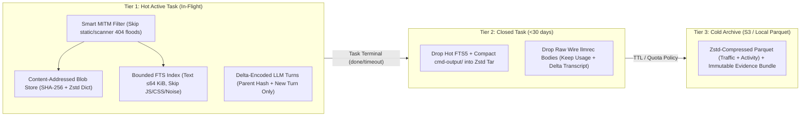
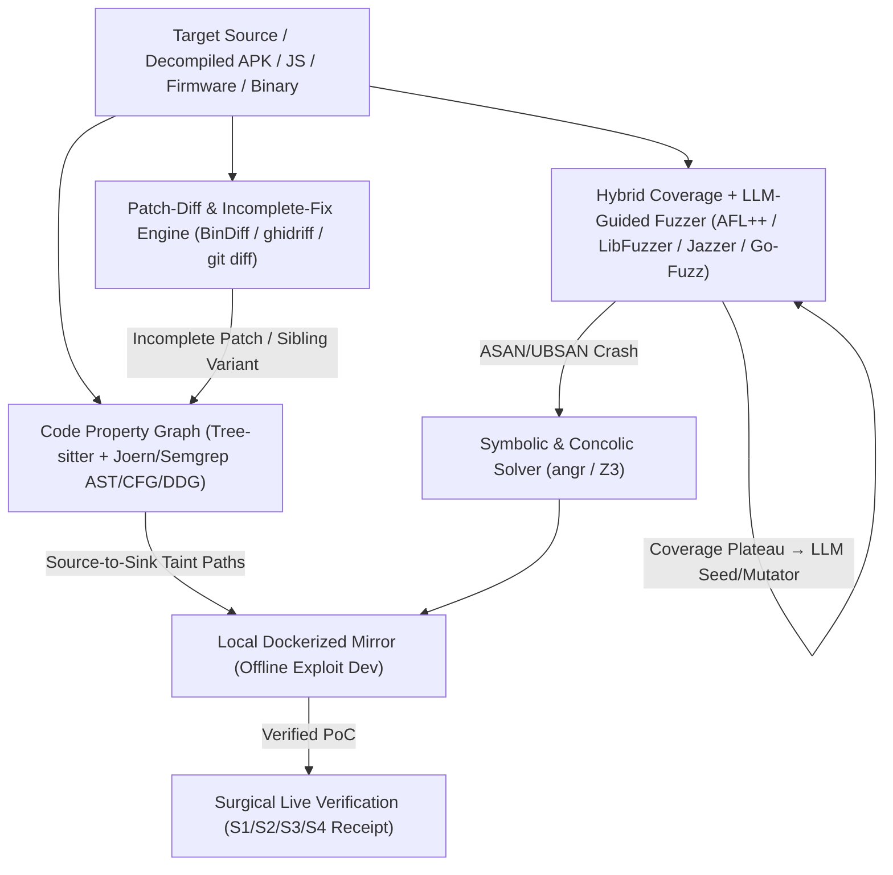

# ArKex 2.0 — Next-Generation Autonomous Pentesting Platform Blueprint

> **Mission**: Evolve ARTEX 1.x into **ArKex 2.0** — fixing the 100 GB+ storage explosion (targeting **90–95% disk reduction**), replacing brittle hand-rolled plumbing with **production-grade Go libraries**, closing real-world security/scope gaps, and introducing breakthrough offensive AI capabilities that make ArKex the undisputed #1 autonomous penetration testing system.

---

## 1. Forensic Root-Cause Analysis: Why ARTEX 1.x Grows Past 100 GB

Direct inspection of the ARTEX codebase (`llmrec/`, `traffic/`, `db/schema.sql`, `agent/`, `sidequestion/`) and workspace disk usage reveals **five compounding storage bugs** that cause rapid, unbounded disk growth:

| # | Culprit | Code Location | Root Cause | Growth Rate & Amplification |
| :--- | :--- | :--- | :--- | :--- |
| **1** | **Quadratic LLM Recording (`O(N²)`)** | `llmrec/llmrec.go` | Records **both** serialized `reqBody` AND full raw wire `RawRequest`/`RawResponse` on *every single turn* into PostgreSQL TOAST tables. A 100-turn worker session re-writes turn 1's messages 100 times × 2 copies, uncompressed, with no TTL. | **~100–300 MB per worker intent** → **5–15 GB per complex task** in PG alone. |
| **2** | **Uncompressed MITM Traffic + 3× FTS5 Trigram Amplification** | `traffic/traffic.go`, `traffic/archive.go` | Stores every HTTP request/response **uncompressed plaintext** (`<=256 KiB` inline in SQLite, `>256 KiB` raw `.bin` blobs), PLUS indexes up to **4 MiB per body** into an FTS5 `trigram` virtual table (~2–3× text size). High-volume tools (`ffuf`, `nuclei`, `sqlmap`, `katana`) routed through `HTTP_PROXY` dump tens of thousands of repetitive 404/JS/HTML bodies with **no auto-retention** and **no scanner noise filtering**. | **10–50 GB** per large web/API engagement; SQLite `index.sqlite` bloats to tens of GB and never shrinks without manual `VACUUM`. |
| **3** | **Unbounded Worker Artifacts, Spill Files & Raw Dumps** | `agent/worker.go`, `data/tasks/`, `backups/` | Every tool output `>30k` chars spills uncompressed to `cmd-output/`. Workers download massive target dumps, APKs, wordlists, and scan logs into `data/tasks/` with zero per-intent disk quota or compression. Backups store uncompressed `.tar` archives. | **3–30+ GB** of raw text, JSON, and binary dumps (`data/tasks` + `dump_drive` + uncompressed `backups`). |
| **4** | **Triple Duplication of Agent History** | `db/schema.sql` (`activity`, `side_question_sessions`), `data/transcripts/`, `data/noa/` | The exact same conversation is stored **4 times**: (1) `llmrec` in PG, (2) `activity` full `detail` in PG, (3) `transcripts/*.jsonl` on disk, and (4) `side_question_sessions` full JSON deep-copy snapshots + `noa/` archives—all uncompressed. | **4× storage multiplier** on every byte of agent context. |
| **5** | **Zero Lifecycle / Retention / Tiering Engine** | `docs/collaboration.md` | `"Automatic retention deletion remains disabled."` Closed/archived tasks keep hot FTS5 indexes, raw `llmrec` wire dumps, and uncompressed `cmd-output/` forever. | Linear unbounded growth → **100 GB+ guaranteed** within weeks. |

---

## 2. ArKex 2.0 Storage Engine: 90–95% Size Reduction Architecture

To permanently cap disk usage and reduce a 100 GB ARTEX deployment to **~4–8 GB** without losing a single byte of forensic evidence, ArKex 2.0 replaces ad-hoc plaintext storage with a **4-Tier Content-Addressed, Zstd-Compressed Storage Engine**:

### Concrete Fixes & Compression Ratios

1. **Delta-Encoded LLM Recording (Fixes `O(N²)` PG Explosion — ~96% Reduction)**
   - Stop storing full `req.Messages` on every turn. Store a **single append-only `llm_messages` table** keyed by `(session_id, turn_seq, content_sha256)` compressed with Zstd, and have `llm_calls` store only `(session_id, up_to_turn_seq, response_msg_id, usage, latency)`.
   - Make full raw wire capture (`RawRequest`/`RawResponse`) **opt-in debug-only with a 24-hour ring buffer** (default: off), instead of permanent PG storage.
   - **Result**: A 100-turn intent drops from **~200 MB → ~2 MB**.

2. **Smart MITM Proxy & Zstd Dictionary-Compressed Traffic Store (~92% Reduction)**
   - **Scanner & Noise Deduplication**: In the MITM addon, detect high-frequency fuzzing/scanning signatures (`ffuf`, `feroxbuster`, `nuclei`, `sqlmap`, `dirsearch` via User-Agent, burst rate `>20 req/s` to the same host, or `404`/`403` template floods) and **Content-Type noise** (`image/*`, `font/*`, `video/*`, `audio/*`, minified `.js`/`.css` bundles). Store **metadata + SHA-256 body hash** only (or sample 1 representative body per `(host, status, body_hash)`), unless the response triggers an anomaly (status change, length outlier, keyword match, or explicit finding bind).
   - **Trained Zstd Dictionary Compression (`klauspost/compress/zstd`)**: HTTP headers, JSON APIs, and HTML share massive structural redundancy. Compressing `exchange_bodies` and blobs with a trained 64 KiB HTTP Zstd dictionary achieves **10–18× compression** at >500 MB/s.
   - **Fix FTS5 Trigram Bloat**: Reduce `maxIndexBody` from `4 MiB` to **`64 KiB`** (or index only structured JSON/HTML/text responses, never minified JS bundles), and **automatically drop FTS5 entries for closed tasks after 7 days** (rebuilding on demand if reopened) + run `PRAGMA incremental_vacuum` automatically on task archive.
   - **Result**: 50 GB of MITM traffic + FTS5 shrinks to **~2–3 GB**.

3. **Unified Single-Source Transcript & Compressed Spill Store (~85% Reduction)**
   - Eliminate the 4× duplication between `llmrec`, `activity.detail`, `transcripts/*.jsonl`, and `side_question_sessions`. Store **one canonical Zstd-compressed event log** per session; `activity` stores lightweight summaries + byte offsets/hashes into the canonical store.
   - `side_question_sessions` references `(session_id, turn_seq)` instead of deep-copying the entire conversation JSON.
   - `cmd-output/` spill files are streamed directly through `zstd.NewWriter` (`.zst`) and capped by a **per-intent disk quota** (default 256 MiB) + automatic cleanup of unreferenced temp files when a task closes (preserving only finding-linked artifacts and explicit loot).

4. **Automated Retention, Quotas & S3/MinIO Offload**
   - Add a background **Storage Governor** with configurable global disk cap (e.g., `ARKEX_MAX_DISK_GB=20`), per-task scratch quotas, automatic Zstd compression of backups (`pg_dump --compress=zstd`), and optional **S3/R2/MinIO** cold tiering for closed task archives.

---

## 3. Pro Go Libraries & Stack Upgrade for ArKex 2.0

ARTEX 1.x relies on pure-Go transpiled SQLite (`modernc.org/sqlite`), basic `net/http`, a single-process `sync.Map` engine, and shell-wrapped CLI tools. ArKex 2.0 should adopt battle-tested, high-performance Go libraries:

| Subsystem | ARTEX 1.x | ArKex 2.0 Pro Library Stack | Why It's Way Better |
| :--- | :--- | :--- | :--- |
| **Compression & CAS** | Plaintext SQLite + raw `.bin` blobs | **`klauspost/compress/zstd`** (with dict) + **`jotfs/fastcdc-go`** (content-defined chunking) | 10–18× compression on HTTP/JSON/logs; cross-task deduplication of shared JS/APKs/dumps. |
| **Job Queue & Horizontal Scaling** | Single-process `Engine` goroutines + `sync.Map` | **`riverqueue/river`** (PostgreSQL-backed transactional job queue) or **Temporal** | Crash-safe distributed worker pools across multiple machines/containers; native retries, priorities, rate limits, and zero lost intents. |
| **Semantic Memory & RAG** | Rule-only `rsi_lessons` string matching | **`pgvector/pgvector-go`** (PostgreSQL `pgvector` + `tsvector` hybrid RRF) | True semantic retrieval of proven exploit chains, WAF bypasses, and target-tech playbooks across engagements (still evidence-gated!). |
| **Native Offensive Recon & OAST** | Shell-out to `curl`/`nmap`/`ffuf` + `dnsx` only | **ProjectDiscovery Go SDKs**: `interactsh` (embedded OAST), `httpx`, `katana`, `subfinder`, `naabu`, `nuclei/v3`, `wappalyzer` | Structured typed Go structs (zero regex parsing of CLI stdout), 10× faster, zero MITM noise pollution, native blind-vuln OOB callbacks. |
| **Stealth HTTP & WAF Evasion** | Standard `net/http` (Go TLS fingerprint = instant Cloudflare/WAF block) | **`refraction-networking/utls`** (JA3/JA4 Chrome/Safari TLS spoofing) + **`quic-go`** (HTTP/3) + **`imroc/req/v3`** | Bypasses TLS-fingerprinting WAFs (Cloudflare, Akamai, Imperva) natively inside `WebFetch` and Go exploit scripts. |
| **Browser Automation** | External `playwright-cli` skill | **`go-rod/rod`** (or `playwright-go`) with stealth + CDP network/DOM hooks | Native Go headless browser for SPA crawling, OAuth/SSO login, DOM XSS verification, and CSWSH/WebSocket testing. |
| **Protocol & Binary Analysis** | HTTP/1.1 only (`go-mitmproxy`) | **`coder/websocket`** + **`bufbuild/protocompile`** (gRPC/Protobuf) + **`smacker/go-tree-sitter`** (AST code audit) | Full HTTP/2, HTTP/3, WebSocket, gRPC interception + true AST/taint-aware white-box code auditing. |
| **Sandboxed Worker Execution** | Host `Bash` subprocess (`os/exec`) | **Docker/Containerd SDK** (`moby/moby/client`) or **Firecracker / gVisor** + **eBPF/netns egress proxy** | Hard disk quotas (prevents runaway dumps), read-only rootfs, zero host compromise, and **unbypassable kernel-level scope enforcement**. |
| **Observability & Metrics** | `log.Printf` + `server_logs` PG table | **`log/slog`** + **OpenTelemetry (`go.opentelemetry.io/otel`)** + **Prometheus** | Real-time dashboards for cost-per-confirmed-finding, token burn by role, model refusal rates, and tool failure attribution. |
| **Cold Analytics & Search** | SQLite FTS5 trigram (`modernc.org/sqlite`) | **PostgreSQL `pg_trgm` / `ParadeDB` (`pg_search` BM25)** + **`parquet-go/parquet-go`** for cold archives | Eliminates the 2nd database engine (SQLite) entirely for hot search, or offloads cold traffic to 15× smaller Zstd-Parquet files. |

---

## 4. Major AI & Offensive Feature Upgrades for ArKex 2.0

### 4.1 Kernel-Level Unbypassable Scope Enforcement (Closing ARTEX's Biggest Safety Gap)
- **The ARTEX 1.x Limitation**: As explicitly noted in `intercept/target_extract.go:62`, *"a command can hide its target, and the process resolves names on its own. The gate detects a declared target; it does not prevent an undeclared connection."* A worker running `python3 exploit.py` or a base64-encoded curl bypasses static argument extraction completely.
- **ArKex 2.0 Fix**: Run every worker inside a network namespace (`netns`) / ephemeral container with **zero direct internet egress** (`iptables`/eBPF drop all non-proxy traffic). Every TCP/UDP/DNS connection **must** traverse ArKex's Transparent Egress Proxy + DNS Resolver, which enforces Target Pins, IP/CIDR Block Rules, and Rate Limits at the **socket layer**. Scope violations become physically impossible—even for compiled binaries or obfuscated scripts.

### 4.2 Native Embedded OAST / OOB Engine (`interactsh` + Event-Driven Wakeup)
- Embed an `interactsh` client/server directly into ArKex with a first-class `oast_generate_payload(tag, intent_id)` tool.
- Automatically tags every blind SSRF, blind XXE, blind XSS, blind SQLi, and blind RCE probe with a unique subdomain correlated to `(task_id, intent_id, asset_id, payload)`.
- The millisecond a DNS/HTTP/SMTP/LDAP callback arrives—even 20 minutes after the worker finished—ArKex records an immutable OAST evidence receipt and fires `TriggerEvent{Kind: "oast_hit"}` to **immediately wake the Planner** to exploit and confirm the vulnerability.

### 4.3 Multi-Identity Auth & Automated Differential Access-Control Matrix (IDOR / BOLA / BAC)
- **The #1 Real-World Pentest Bottleneck**: Modern web/API bugs are overwhelmingly Broken Object Level Authorization (BOLA/IDOR), Broken Function Level Authorization (BFLA), and multi-tenant leaks.
- **ArKex 2.0 Auth Vault**: Operators (or the Browser Extension) supply 2–4 identities per engagement (`Unauth`, `User A`, `User B`, `Admin`) with auto-refreshing JWT/OAuth/Cookie hooks.
- **Automated Differential Replay Engine**: Whenever any worker discovers a new authenticated endpoint in the MITM proxy, a lightweight background Go analyzer automatically replays safe `GET`/read endpoints across `Unauth`, `User B`, and `User A`, computing structural JSON/DOM diffs and flagging potential IDOR/BFLA anomalies straight into the Exploration Graph for a worker to verify!

### 4.4 DAG Hypothesis Planner & Cross-Worker Gadget Chaining
- Upgrade ARTEX's linear `TodoStore` into a **Hypothesis & Attack-Path DAG** in PostgreSQL:
  - Each hypothesis tracks `confidence_score`, `preconditions`, `blocked_by`, and `potential_impact`.
  - **Automatic Gadget Synthesis**: A lightweight graph-pattern watcher detects composable primitives discovered by *different* workers (e.g., Worker #1 finds *Arbitrary File Write* + Worker #2 finds *Nginx/PHP-FPM config* or *SSTI template path* → automatically surfaces a high-priority `chain_candidate` trigger to the Planner).
  - **Cross-Task Negative-Result Index**: Before dispatching an intent, the Planner checks a normalized `(asset_fingerprint, vuln_class, method)` negative ledger so ArKex never wastes tokens re-testing already-proven-clean surfaces across tasks.

### 4.5 Cognitive-Tiered Model Routing + Automatic Refusal Fallback
- **Dynamic Role & Turn-Level Routing**:
  - **Tier 1 (Fast/Cheap — Flash / Haiku / Local 14B–32B)**: Recon parsing, JS route extraction, cold-graph compaction, traffic triage, duplicate checking.
  - **Tier 2 (Frontier Reasoning — Pro / Opus / o3)**: Planner strategy, novel vulnerability discovery, multi-step exploit chaining, 5-axis adversarial verification.
  - **Tier 3 (Local Uncensored / Security-Tuned via Ollama/vLLM)**: Automatically invoked when a cloud provider returns a safety refusal, `content_filter` finish reason, or repeated empty responses during legitimate exploit payload crafting—detecting refusal phrases (`"I cannot assist with..."`, `"against my safety policy"`) in `llmpool` and **seamlessly failing over that single turn to the local security model** without breaking the session!

### 4.6 S2 Browser & OAST Receipt Verification (Zero-Hallucination Standard)
Extend ARTEX's S1 Verbatim HTTP Receipt Verifier (`server/finding_verification.go`) to cover **all** vulnerability classes:
- **S1 (HTTP Receipt)**: Verbatim quote in captured MITM response body (`POE >= L3`).
- **S2 (Browser Receipt)**: Headless `go-rod` executes the PoC and captures verifiable DOM mutation, JS execution proof, or cross-origin cookie/storage exfil + screenshot/HAR.
- **S3 (OAST Receipt)**: Cryptographically correlated `interactsh` DNS/HTTP callback log.
- **S4 (Shell/Exploit Receipt)**: Signed stdout/stderr transcript from the sandboxed worker container (e.g., `uid=0(root)` or target canary file read).

### 4.7 Gray-Box / White-Box Hybrid AST Auditing (`tree-sitter` + Semgrep/CodeQL)
- When source code, decompiled APKs, or harvested JS bundles are available, ArKex 2.0 indexes them with **Tree-sitter AST + Sink-to-Source Call Graphs** into the Asset Graph.
- Workers can query `find_sinks(lang, vuln_class)` and `trace_dataflow(endpoint → sink)` to pinpoint exact file:line vulnerabilities, then immediately pivot to live dynamic PoC verification against the running target—combining white-box precision with black-box S1/S2 proof!

### 4.8 Loop C Benchmark-Gated Self-Improvement (Completing `RSI.md`)
- Implement the held-out benchmark harness (e.g., XBOW / CyberSecEval / Juice Shop / custom vulnerable microservices) to safely unlock **Loop C**:
  - Live tasks propose candidate prompt/skill improvements + capture skill gaps.
  - Nightly isolated benchmark runs A/B test candidate diffs against baseline (measuring **confirmed findings, false-positive rate, tokens/finding, wall-time**).
  - Operator approves winning diffs in one click with immutable safety surfaces and instant rollback.

---

## 5. Super-Advanced Offensive & 0-Day Discovery Engine

To push ArKex 2.0 beyond standard N-day / OWASP scanning into **novel 0-day vulnerability research, complex protocol exploitation, and red-team-grade attack chaining**, ArKex 2.0 adds five specialized offensive engines orchestrated directly by the Planner and Workers:

### 5.1 Automated 0-Day Vulnerability Research Pipeline (White-Box, Gray-Box & Binary)

1. **Code Property Graph (CPG) + Automated Variant Multiplication**
   - Indexes target source repositories, harvested JS/TS bundles, decompiled Java/Kotlin/C# assemblies, and extracted firmware filesystems into a unified **AST + Control-Flow + Data-Flow Graph** (`go-tree-sitter` + Joern/Semgrep bridge).
   - **0-Day Variant Hunting**: Whenever a worker confirms *one* vulnerability (or imports a 1-day advisory/patch), ArKex automatically abstracts the root-cause anti-pattern (missing auth middleware, unsafe sink, broken sanitizer, parser mismatch) into a CPG/Semgrep rule and sweeps the entire codebase—and sibling microservices—for **previously unknown 0-day variants**.
2. **Patch-Diffing & Incomplete-Fix Exploitation (`BinDiff` / `ghidriff` / `git diff`)**
   - Diffs pre- and post-patch binaries/commits to isolate newly introduced bounds checks, authorization guards, and input sanitizers.
   - Reasons backward from the patched sink to all reachable entry points, then systematically tests for **bypassable/incomplete patches** (e.g., fix applied to `POST` but missed on `PUT`/`PATCH`, regex bypass, canonicalization order bug, or sibling handler left unpatched)—one of the highest-yield sources of real-world 0-days.
3. **LLM-Guided Hybrid Fuzzing Orchestrator (`AFL++` / `LibFuzzer` / `Jazzer` / `Atheris` / `go test -fuzz`)**
   - Workers autonomously write targeted fuzz harnesses for C/C++/Rust/Go/Java/Python parsers, custom binary protocols, archive/media/PDF processors, and deserializers inside ephemeral containers with `ASAN`/`UBSAN`/`MSAN` enabled.
   - **Coverage-Plateau Breakout**: When coverage stalls, ArKex parses `llvm-cov`/`gcov` uncovered branch reports, feeds the blocking conditional code to a Tier-2 reasoning model, and generates **structure-aware seed corpora and custom mutators** that satisfy magic bytes, CRCs, length fields, and multi-step protocol states.
   - **Automated Crash Triage & Exploitability Classification**: Deduplicates crashes by stack hash, minimizes reproducers (`afl-tmin`), classifies primitives (`heap-buffer-overflow`, `use-after-free`, `OOB-write`, `type-confusion`), and hands constraints to the symbolic solver.
4. **Symbolic Execution & Concolic Solving (`Z3` / `angr` Native Tool)**
   - Exposes `solve_constraints` (Z3) and `angr_reach` as first-class tools so workers mathematically solve complex path predicates, custom token/checksum generators, PRNG seed recovery, obfuscated JS/WASM checks, and crypto padding/oracle math in milliseconds instead of burning dozens of LLM turns guessing.
5. **Local Exploit-Development Sandbox (`executed-lab` → `executed-live`)**
   - When recon identifies an open-source framework, library, or container image, ArKex can spin up a **local Dockerized mirror** to iteratively develop, debug, and perfect 0-day/N-day exploit chains (gadget chains, heap grooming, ROP, blind SQLi tuning) completely offline with zero target noise—then fire a single clean, verified PoC against the authorized target.

### 5.2 Super-Advanced Web, Protocol & Distributed-Systems Attacks

1. **Single-Packet Race-Condition & HTTP/2–HTTP/3 Desync Engine**
   - Native Go raw-socket / custom HTTP/2 frame & `quic-go` engine implementing **Last-Byte Sync** and **HTTP/2 Single-Packet Attacks** (packing 20–50 requests into one TCP segment to eliminate network jitter and reliably trigger sub-millisecond TOCTOU, double-spend, coupon/credit abuse, rate-limit bypass, and concurrent auth-state corruption).
   - Automated differential probing for **`CL.TE`, `TE.CL`, `H2.CL`, `H2.TE`, `H2.0` request smuggling**, **Web Cache Poisoning** (unkeyed headers/ports/host overrides, fat GET), and **Web Cache Deception** (path-normalization mismatches between CDN/reverse-proxy and origin).
2. **Parser-Differential & Polyglot Synthesis Engine**
   - Systematically hunts impedance mismatches across stacked security boundaries:
     - **WAF vs. Origin**: Charset/Unicode normalization (`NFKC`), JSON duplicate-key precedence, JSON comment/trailing-comma quirks, HTTP Parameter Pollution (`?id=1&id=2`), chunked-encoding extensions, and multipart boundary confusion.
     - **Auth & Identity Parsers**: JWT (`alg:none`, RS256→HS256 key confusion, `kid` path traversal/SQLi, `jku`/`x5u` SSRF, JWE), OAuth/OIDC (`redirect_uri` parser differentials, state/PKCE downgrade, token-audience confusion), and SAML XML Signature Wrapping (`XSW1–XSW8`).
3. **Stateful Business-Logic & Workflow FSM Fuzzer**
   - Automatically infers the target's **Finite State Machine (FSM)** from captured MITM and browser traffic (e.g., `signup → email_verify → mfa → checkout → payment → fulfill`).
   - Tests **state skipping**, **out-of-order replay**, **cross-step token reuse**, **role/price/quantity parameter tampering**, and **numeric/serialization edge cases** (negative quantities, IEEE-754 float rounding, int64 wrap-around, array-vs-scalar type confusion, mass assignment).
4. **Undocumented GraphQL, gRPC & Proprietary Binary Protocol Reversing**
   - **GraphQL**: Recovers schemas when introspection is disabled via field-suggestion/error-oracle mining; tests alias-based rate-limit bypass, batching, nested-depth DoS, and per-field/per-resolver authorization gaps.
   - **gRPC & Binary Protocols**: Uses `protocompile` + wire-type inference to reconstruct `.proto` schemas from reflection, mobile/JS clients, or raw captures; recovers custom TCP/UDP/WebSocket framing (length prefixes, opcodes, checksums) and runs structure-aware mutation fuzzing.

### 5.3 Deserialization, Gadget-Chain Synthesis & Cloud/Identity Attack Graphs

1. **Automated Deserialization & Gadget-Chain Prober**
   - Automatically detects serialized objects across traffic and parameters by magic bytes (`rO0AB`, `AAEAAAD`, PHP `O:`, Python pickle, Ruby Marshal, Java RMI/JMX, .NET ViewState/BinaryFormatter).
   - Uses non-destructive **`interactsh` DNS/timing gadget probes** to fingerprint available classpath/runtime libraries before synthesizing the minimal verified RCE/file-read chain.
2. **Cloud, IAM & Kubernetes Shortest-Path Escalation Engine**
   - Extends the Asset Graph with IAM principals, roles, OIDC trust policies, K8s RBAC bindings, service accounts, and IMDS/metadata reachability across **AWS, GCP, Azure/Entra ID, and EKS/GKE/AKS**.
   - Runs BloodHound-style deterministic shortest-path graph queries for `AssumeRole`/PassRole escalation, CI/CD OIDC trust abuse, SSRF-to-IMDSv1/v2 credential theft, and container-to-node/cluster escape paths.

### 5.4 Adaptive Closed-Loop WAF Evasion & Stealth Intelligence

- **Grammar-Guided AST Mutator**: When `Guard.postToolUse` detects a WAF/EDR block (`403`/`429`/Cloudflare/ModSecurity/AWS WAF/Akamai), ArKex switches from blind LLM retries to a deterministic **AST-preserving payload mutator** (SQL/XSS/CMDi/Path syntax transforms, comment/whitespace/encoding/JSON-Unicode/`Content-Type` switching) paired with **`uTLS` JA3/JA4 Chrome/Safari fingerprint spoofing** and egress proxy rotation.
- **Persistent Bypass Memory**: Stores proven `(waf_vendor, vuln_class, bypass_transform, success_rate)` records in `pgvector` so future engagements bypass the same WAF on the very first probe.

---

## 6. ArKex 2.0 Phased Implementation Roadmap

| Phase | Focus | Key Deliverables | Impact |
| :--- | :--- | :--- | :--- |
| **Phase 1: Storage Surgery** (Weeks 1–2) | Stop the 100 GB bleeding | Delta `llmrec` + disable permanent raw wire capture; Zstd dict compression on `traffic` + scanner/404 noise filter; cap FTS5 at 64 KiB + auto-drop on closed tasks; Zstd `cmd-output/` + per-intent 256 MiB quota + Storage Governor TTL. | **90–95% disk reduction** immediately on existing deployments. |
| **Phase 2: Kernel Scope & Pro Core** (Weeks 3–5) | Hardening + Pro Libraries | Ephemeral Docker/netns worker sandboxes with forced transparent egress proxy (unbypassable scope); `uTLS` JA3/JA4 spoofing; embedded `interactsh` OAST with `oast_hit` planner trigger; `riverqueue/river` distributed job queue. | Unbypassable scope, WAF resilience, native blind-vuln detection, multi-node scaling. |
| **Phase 3: Offensive Intelligence** (Weeks 6–9) | 10× Web/API/Cloud Capability | Multi-identity Auth Vault + automated differential IDOR/BOLA matrix; `go-rod` browser automation & S2 verification; Single-Packet Race & H2/H3 Desync engine; ProjectDiscovery native SDKs; `pgvector` semantic memory; refusal-aware Tier-3 local LLM failover; Grammar-Guided WAF Mutator. | Massive leap in real-world critical findings (IDOR, race conditions, smuggling, auth bypass, blind SSRF/RCE, DOM XSS). |
| **Phase 4: 0-Day Research & RSI** (Weeks 10–14) | White-Box, Fuzzing & Self-Evolution | Tree-sitter/Joern CPG + 0-day variant multiplication; Patch-Diff & incomplete-fix engine; Hybrid AFL++/LibFuzzer/Jazzer + LLM coverage-breakout fuzzer; Z3/angr symbolic solver tool; Local Docker exploit-dev mirror; DAG Hypothesis & Gadget-Chaining Planner; Loop C benchmark-gated evolution. | True autonomous 0-day discovery, binary/source exploitation, and measurable continuous self-improvement. |
