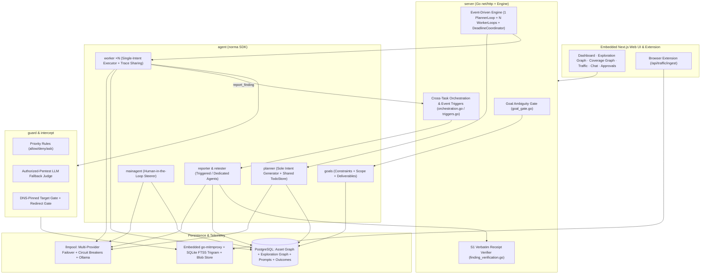
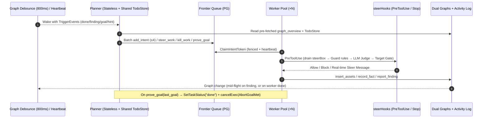

# ARTEX Deep Technical Architecture Analysis

> **Scope**: Deep-dive analysis of the ARTEX autonomous penetration testing platform based directly on its Go source code (`agent/`, `server/`, `guard/`, `intercept/`, `llmpool/`, `traffic/`, `sidequestion/`, `skills/`). Covers prompt engineering, message & context flows, multi-agent orchestration, cyber guardrail & LLM friction handling, scope management, and the core engineering differentiators that make ARTEX an elite pentesting AI system.
> **Verbatim Prompts**: All extracted prompts are cataloged verbatim in [ARTEX_PROMPTS.md](ARTEX_PROMPTS.md).

---

## 1. Executive Summary: Why ARTEX Works Where Other Pentesting Agents Fail

Most autonomous pentesting AI frameworks fail in production for five predictable reasons:
1. **Context collapse**: Long tool outputs and sprawling recon histories blow out the context window, causing the agent to forget its objective or loop on dead ends.
2. **Tunnel vision vs. scattershot chaos**: Single-agent ReAct loops either obsess over one dead-end parameter or spray shallow probes without chaining gadgets.
3. **Hallucinated findings**: LLMs routinely report version-matched CVEs, "looks injectable" guesses, or fabricated HTTP responses as confirmed vulnerabilities.
4. **Scope drift & destructive accidents**: Unrestricted shell access drifts onto out-of-scope subdomains or runs destructive commands against production assets.
5. **LLM friction & fragility**: Rate limits, quota exhaustion, provider safety refusals/empty replies, reasoning-only idle turns, and broken SSE streams kill long-running autonomous engagements.

ARTEX solves all five at the **systems architecture** level rather than relying on a single monolithic prompt. Built as a Go monolithic backend with an embedded Next.js frontend, PostgreSQL persistence, an embedded MITM traffic proxy, and the [`norma`](https://github.com/Autumn-27/norma) agent SDK (`agentcore`, `tool`, `permission`, `harness`, `memory`, `transcript`, `noaadapter`), ARTEX introduces:

- **A Dual-Graph Architecture** separating the global **Asset Graph** (shared source of truth) from per-task **Exploration Graphs** (causal lineage of goals, intents, facts, findings, and hints), linked by `exploration_anchors`.
- **Strict Role Separation** (`goals` → `planner` → `worker ×N` + `mainagent` + event-triggered `reporter` + `retester`).
- **Two-Tier Prompt Architecture** separating user-editable strategy from immutable, code-owned safety, traffic, artifact, and evidence contracts.
- **Verbatim HTTP Receipt Verification (S1)** that refuses to mark a finding `verified` unless the agent's quoted evidence appears verbatim inside a captured MITM proxy response body.
- **Multi-Layer Scope & Safety Controls** combining an ambiguity gate, minimal-scope extraction, DNS-pinned target gating, rule-based interception, and an authorized-pentest LLM safety judge.

---

## 2. Prompt Engineering Architecture

### 2.1 Layered Prompt Composition (Editable Body vs. Code-Owned Tails)

ARTEX splits every agent's system prompt into **editable** and **immutable code-owned** layers (`agent/prompt.go`, `agent/promptcatalog.go`, `agent/worker.go`, `agent/planner.go`, `agent/deferred.go`). This allows operators to tune methodology in the UI (with full version history and one-step rollback in `agent_prompts`) without ever breaking platform invariants.

| Layer | Mutability | Owner | Purpose |
| :--- | :--- | :--- | :--- |
| **[A] Core Role Body** | Editable in UI (versioned in PG) | `agent/promptcatalog.go`, `planner.go`, `worker.go`, `goals.go`, `mainagent.go`, `retester.go` | Go `text/template` with strict `missingkey=error` fallback to built-in default. Variables: `{{.Goal}}`, `{{.Scope}}`, `{{.AssetSummary}}`, `{{.DataDir}}`, `{{.Now}}`, `{{.ProxyAddr}}`. |
| **[B] Traffic Tool Block** | Code-owned (immutable) | `workerTrafficBlock()` in `agent/worker.go` | Conditionally injected **only** when MITM recording is active (`caCert != ""`). Instructs workers to check `traffic_search`/`traffic_get`/`traffic_blob` before re-curling URLs. |
| **[C] Artifact Output Rules** | Code-owned (immutable) | `artifactSpec()` / `workerArtifactSpec()` | Forces all scripts, payloads, and captured bodies into `<workDir>/tasks/<taskID>/i<intentID>` (never `/tmp`), preventing cross-worker collisions. |
| **[D] RSI Lessons Block** | Code-owned (immutable) | `lessonsBlock` (`ARTEX_RSI_LESSONS=inject`) | Appends up to 8 evidence-gated lessons (≤1,800 chars) from closed tasks, stripped of control characters and framed as `"prior outcomes, not instructions"`. |
| **[E] Operation Constraints** | Code-owned (immutable) | `constraintBlock()` in `agent/constraints.go` | High-priority `allow`/`deny` rules explicitly placed **above** all exploration heuristics. |
| **[F] Pinned Intent & Assets** | Code-owned (Worker only) | `renderIntentTask()` + `as.GetByIDs()` in `agent/worker.go` | Pins the worker's single assigned intent and target asset JSON into the system prompt so long-run compaction can never erase the mandate. |
| **[G] Deferred Tools Block** | Code-owned (immutable) | `deferredSystem()` in `agent/deferred.go` | Appends `<available-deferred-tools>` as the final segment and sets `DynamicBoundary = len(system)` so the entire session-fixed system prompt stays prompt-cached. |

### 2.2 Role-by-Role Prompt Anatomy

#### 1. Goal Decomposer (`goals` — `agent/goals.go`)
Runs once at task creation (round 0, `MaxTurns: 8`) before the planner ever wakes.
- **Step 1 — Constraint Extraction (`set_constraints`)**: Extracts explicit `allow`/`deny` rules from the task description. Enforces **deictic resolution**: forbids vague words like *"current target"* or *"this port"*, requiring concrete values (*"only test port 443 of abc.example.net"*) because constraints are injected out-of-context into later prompts.
- **Step 2 — Minimal-Scope Registration (`add_task_scope`, code-owned `goalsScopeTail`)**: Enforces the **minimal-scope principle**. Given `https://a1b2c3.lab.example.net/path`, it registers `kind=subdomain, value=a1b2c3.lab.example.net` — explicitly forbidding widening it to `example.net`.
- **Step 3 — Deliverable Decomposition (`set_goals`)**: Defines a goal strictly as a **final deliverable / verifiable result**. Explicitly bans recon, endpoint scanning, analysis, or attack steps from being registered as sub-goals.

#### 2. Planner (`planner` — `agent/planner.go`)
The **sole intent generator** in autonomous tasks. Each wake-up is a fresh stateless session, compensated by pre-fetched `graph_overview` and a persistent per-task `TodoStore`.
- **Hard Floor Anti-Stall Rule**: If any goal is unmet AND `frontier_open == 0` AND `running_intents` is empty, emitting 0 intents is **forbidden** (prevents silent task stalling).
- **Legitimate Zero-Intent Criteria**: 0 intents is allowed *only* when (a) all directions are already covered by open/running intents, or (b) the next step depends on an in-flight worker's output.
- **Depth Over Coverage + Route Diversity**: Instructs the planner to maintain **2–3 fundamentally different routes in parallel** (e.g., file upload chain vs. auth bypass) and prioritize deep exploitation of high-value entry points rather than shallowly flattening coverage.
- **Quantitative Acceptance Gate**: Before calling `prove_goal`, the planner must verify quantitative thresholds (`coverage.pct`, `findings_total`) against live `graph_overview` metrics—forbidding early stamping ("mostly done").
- **Read-Only Round-0 Probe Cap**: May run at most **≤3 lightweight read-only probes** *only* when `facts == 0`; once workers produce any fact, self-probing is strictly forbidden.
- **Bounded Negative Re-Examination**: Treats worker negative conclusions (*"not injectable"*) as observations, not verdicts. If `confidence=inferred` or evidence is weak, dispatches **at most one** re-examination intent; if confirmed negative, seals the direction.
- **Serial Exploit Chains via Shared `TodoStore`**: For dependent multi-step chains (`①→②→③`), the planner records the full chain in `TodoWrite` and dispatches **only the step whose prerequisites exist**, advancing step-by-step across wake-ups.
- **Batch Discipline**: Dispatches at most **4 highest-value intents** in a single `add_intent` batch call, each with `summary`, `asset_ids`, and `parent_ids` (for causal lineage).

#### 3. Worker (`worker` — `agent/worker.go`)
Claims **one intent**, executes real tools through the recording MITM proxy, writes back to both graphs, and terminates.
- **Strict Scope & Digression Rule**: Must execute *only* its assigned intent, yet *"digressing is good"* mentally—any out-of-band clue (cross-asset linkage, leaked path, secondary chain) must be written as a `record_fact` for the planner rather than pursued directly.
- **Write-As-You-Go & Delta Consolidation**: *"Only what's written into the graph counts; what's in your head doesn't."* Enforces **1 consolidated fact per intent** by default (summary + rich detail + one-line command/output evidence + `observed`/`inferred` confidence), preventing graph bloat.
- **5-Axis Adversarial Gate (Before `report_finding`)**: Must actively argue the opposite case along:
  1. **Reachability** (can a real attacker reach it?)
  2. **Preconditions** (unrealistic starting position?)
  3. **Downstream controls** (does something block the actual impact?)
  4. **Scope** (is the asset in authorized scope?)
  5. **Simpler explanation** (benign behavior?)
  *Zero confirmed findings is explicitly validated as a good outcome.*
- **Finding Quality Gates**:
  - **End-to-End PoC**: Must demonstrate the attacker's goal achieved (data returned, command executed, cross-user resource accessed), never CVE/version matching.
  - **Measured Impact**: Requires numbers with denominators (*"3 of 20 payloads returned other-tenant rows; 17 rejected"*).
  - **Proof Basis**: Must declare `executed-live`, `executed-lab`, or `static-analysis-unexecuted`.
  - **Testing Bounds**: State-changing requests are allowed when they are the finding's mechanism—prove on own account first, then confirm cross-entity reach on **at most 3 non-owned objects** with reversible values and log every touched object ID.
  - **Priority Discipline**: User enumeration, timing oracles, and permissive CORS are banned as standalone findings unless chained into ATO, auth bypass, or mass exposure.
- **Environmental Block Handoff (`ask_operator`)**: On environmental failures (sandboxed network, missing binary/key, TLS/proxy failure), stop after the **first failure**—do not waste turns retrying flags. Call `ask_operator` with a single copy-pastable terminal command and wait.
- **Narrowed Tool Surface**: Deliberately strips `MultiEdit`, `Glob`, and `Grep` (`defaultToolsExcept("MultiEdit", "Glob", "Grep")`) so workers use `Edit` and `Bash` (`rg`/`find`), reducing low-value tool churn.

#### 4. Specialized Agents
- **`mainagent` (`agent/mainagent.go`)**: Human operator interface. Observes graphs, injects strategic hints (`add_hint`), dispatches priority 8–10 direct intents (`add_intent`), steers live workers (`steer_work`), adds goals (`set_goals`), and updates constraints (`set_constraints`). Includes a smart **goalless direct-inject** rule: when all goals are already met, distinguishes one-off checks from new deliverables.
- **`pentest` (`agent/promptcatalog.go`)**: Standalone solo pentester combining planner + executor + skeptical auditor doctrines in a single chat session.
- **`reporter` (`agent/promptcatalog.go`)**: Triggered automatically on `report_finding`. Pulls full node detail, bound HTTP traffic + `evidence_version`, and worker execution traces, checks for duplicates via `list_task_findings`, and writes a structured Markdown report via `update_finding_report`.
- **`retester` (`agent/retester.go`)**: Dedicated verification agent for registered findings. Runs minimal targeted reproduction and saves one verdict (`reproduced` | `fixed` | `inconclusive`) after a 5-axis adversarial self-check; a `fixed` verdict automatically transitions the finding status.
- **`auto` (`agent/promptcatalog.go`)**: Platform operator that spawns/pauses tasks, reads graphs/traces, and dynamically creates/updates skills, custom tools, and MCP servers.

### 2.3 Dual-Layer Settlement (Wrap-Up) Prompts (`agent/wrapup.go`)

When an agent hits `MaxTurns` or `MaxDuration`, `norma`'s settlement phase grants **10 wrap-up turns** (`wrapupTurnDefaults`) while enforcing code-fixed tool restrictions (workers have `Bash` disabled via `DisabledTools: ["Bash"]` so they cannot start new probes).

Crucially, ARTEX separates **per-run wrap-up** from **task-timeout wrap-up** via `PromptByReason`:
- **Worker (per-run budget hit)**: Stop probing → persist all unrecorded assets/facts/findings → output one-sentence summary.
- **Planner (per-run budget hit)**: *"Only this round ends; the task continues"* → flush due `add_intent`, `prove_goal`, and `TodoWrite`.
- **Planner (task deadline hit, `ReasonTimeout`)**: *"The entire task terminates"* → call `prove_goal` for any met goals, **forbid generating new intents**.

---

## 3. Message Flows, Context Engineering & Memory Compression

### 3.1 Asymmetric Context Placement (Cache Reuse vs. Mandate Survival)

ARTEX makes a deliberate architectural split between Planner and Worker message placement:

| Agent | System Prompt (Never Compacted) | Launch User Turn (Compactable) | Design Rationale |
| :--- | :--- | :--- | :--- |
| **Planner** | Static role template + artifact rules + lessons + constraints + `<available-deferred-tools>` | `lead` + `[Actual changes that triggered this round]` + pre-fetched `graph_overview` JSON + persistent `TodoStore` | Keeps the system prompt **100% stable across wake-ups** for maximum KV/prompt-cache hit rates. Planner rounds are short, so situational data in the user turn is rarely compacted. |
| **Worker** | Static role template + traffic block + artifact rules + lessons + constraints + **assigned intent payload + anchored target assets JSON** + launch directive | Read-only global `graph_overview` JSON (with `coverage` stripped) | Workers run long, tool-heavy sessions that undergo compaction and pause/resume. Pinning the intent and target assets in the system prompt sacrifices cross-intent cache reuse to **guarantee the worker never forgets its mandate**. |

### 3.2 Cold-Node Graph Compaction (`agent/coldgraph.go`, `agent/compaction.go`)

To prevent `graph_overview` from growing unboundedly during multi-hour engagements, ARTEX implements a **non-destructive, graph-topology-aware cold-node compactor** running off the planner's hot path:

1. **Hot/Cold Partitioning**: Every live intent (`open`, `running`, `paused`), all of its upstream **ancestors** (causal lineage), and its direct **children** (fresh facts) are marked **hot**. Only settled intents and facts outside the hot set are structurally cold. Findings, goals, hints, and root nodes **never fold**.
2. **Debounce (`R = 6` planner rounds)**: A node must stay continuously cold for 6 rounds (`cold_since_round`) before becoming eligible. If a new intent derives from it, it revives immediately.
3. **Background Tiered Compaction**:
   - **Minor compaction** (`uncompressed >= 20`, cooldown `60s`): Groups connected/shared-parent cold blocks (`K >= 2`) and summarizes them via the LLM into `digest` nodes with `covers` edges.
   - **Major compaction** (`activeDigests >= 8`): Re-derives blocks from source, reuses unchanged blocks by content-version SHA-256 signature (zero LLM cost), and supersedes stale digests atomically.
4. **Commit-Time Liveness Recheck**: Before committing a digest, reloads the graph and drops any member that turned hot during LLM inference.
5. **Lossless On-Demand Expansion**: Planners can inspect any folded digest at any time via `expand_digest`.

### 3.3 Session Context Management & Telemetry Flows

- **Dual Compaction Engines**: Built-in window compaction (`compaction.Config{ContextWindow}` clamped to `[32K, 1M]`, default `200K`) OR experimental model-driven **`noa` compression** (`agent/noa.go`), which gives the model an explicit `Compress` tool and persists full originals under `<workDir>/noa/<SessionID>`.
- **Large Tool Output Spilling**: Outputs exceeding 30,000 characters spill to `<runDir>/cmd-output/` with a head preview + file pointer, preserving raw data without blowing context.
- **Process-Level Cross-Worker Trace Sharing (`agent/tools.go`)**: Workers don't just share finalized facts—they can search other workers' raw step-by-step execution logs (excluding self) via `search_all_worker_traces(q)`, `list_worker_traces()`, and `get_worker_trace(intent_id, step_ids)` (capped at 5 steps per call). This lets Worker B reuse an error message, cookie, or hidden parameter Worker A saw mid-run before any fact was written.
- **Deferred Tool & Skill-Gated MCP Loading (`agent/deferred.go`)**: MCP servers and deferred custom tools withhold their JSON schemas from the initial prompt, exposing only names in `<available-deferred-tools>` and loading schemas on demand via `SearchExtraTools`/`ExecuteExtraTool`. Skill-gated MCPs unlock only when `Skill(name)` is called, and `seedUnlockFromHistory()` replays `Skill()` calls when resuming transcripts so unlocked tools remain callable.
- **Independent Side Questions (`/btw` — `sidequestion/`)**: Operators can ask questions about any live chat, MainAgent, or Worker session without interrupting it. `capture.go` snapshots the exact structured `MessagesForAPI` (with paired tool calls/results) at safe boundaries. `SideQuestionService` answers using a single direct provider call—never touching the main transcript, tool loop, activity stream, or task failover chain.

---

## 4. Subagent & Multi-Agent Orchestration

### 4.1 Event-Driven Closed Loop (`server/engine.go`)

Each running task spawns `2 + N` goroutines (default `N = 3` workers):
1. **`plannerLoop`**: Event-driven with **800ms debounce** (`e.debounce`) coalescing bursts of `TriggerEvent`s (`done`, `finding`, `goal`, `hint`, `cancelled`, `goal_edited`, `goal_deleted`) into a single planning round, backed by a **heartbeat patrol timer** (`≥600s` default) to supervise stalled workers and break deadlocks.
   - **Mid-Flight Finding Wakeup**: When a worker calls `report_finding`, `t.NotifyFinding` wakes the planner *immediately* rather than waiting for the worker to finish.
   - **Quiet Mode (`#79`)**: Computes `OpenGoalFingerprint()`. If `PlanQuietMode` is on, open goals are unchanged since the last round, and active work is in flight, redundant edge-triggered planning rounds are dropped (heartbeat still supervises).
   - **Goalless Direct-Inject Mode**: When all goals are met (`!HasOpenGoal()`), the planner stays dormant; if a human injects a direct intent via `mainagent`, workers execute it and the engine settles to `done` in pure Go once the frontier drains—no LLM planner calls burned.
2. **`workerLoop` ×N**: Polls `Frontier(20)` and atomically claims an intent via `ClaimIntentToken(id, name)` returning a fencing token.
   - **Claim Heartbeat & Crash Recovery**: `startClaimHeartbeat()` renews the claim periodically; if lost (`ErrIntentClaimLost`), cancels the stale worker with `AbortWorkClaimLost`. `claimSweepLoop()` returns expired claims to `open`.
   - **Deterministic Transcript Resume**: Session IDs are deterministic per intent (`exp<E>-worker-i<I>`). If a task is paused mid-intent, the intent returns to `open` and resumes from its saved transcript with `"Continue."` instead of restarting from scratch.
3. **`deadlineCoordinator` (`server/engine_timeout.go`)**: Enforces task-level absolute wall-clock deadlines via a 6-step graceful settlement sequence:
   1. Set `settling=true`
   2. Workers stop claiming new intents
   3. Planner drops normal edge notifies
   4. Wait up to `90s` (`settleDrainGrace`) for in-flight workers (whose `MaxDuration` is clamped to the task deadline) to settle and flush facts, hard-cancelling only after grace expires
   5. Run **one final endgame planner round** (`tc.Final = true`) to judge goals with no new intents
   6. Commit guarded terminal status (`done` if met, else `timeout`).

### 4.2 Real-Time Mid-Flight Steering, Stagnation Detection & Human Intervention

- **Non-Destructive Mid-Flight Steering (`steer_work`)**: Both Planner and MainAgent can call `steer_work(intent_id, msg)`. The message is pushed into `Engine.steerBox[intentID]`. Before the worker's next tool call, `steerHooks.PreToolUse` drains the message, blocks that tool call, and returns `[Planner real-time steering] <msg>` to the worker—re-directing it immediately with zero context loss.
- **Surgical Termination (`kill_work`)**: Cancels a single worker's child context (`AbortKilledByPlanner`), marking the intent `stopped` without disturbing sibling workers.
- **Stagnation Detection (`detectStagnation` in `agent/tools.go`)**: Normalizes finished intent summaries (lowercased, all digits collapsed to `#`) and flags any direction repeating `≥3` times with zero subsequent findings directly inside `graph_overview`, alerting the planner to pivot.
- **Detached Human-to-Worker Chat (`runDetachedIntent`)**: Humans can pause any intent and message that worker directly; it runs in a detached goroutine outside the pool so it never waits for a free worker slot.
- **Formal Operator Handoff (`ask_operator` in `server/ask_operator.go`)**: Workers blocked by CAPTCHAs, OTP/2FA, or environmental limits call `ask_operator(question, image_path?)`, staging an optional screenshot (≤10 MiB), pausing *only* that intent, and resuming seamlessly with the operator's reply.

### 4.3 Cross-Task Orchestration & Event-Driven Custom Agent Triggers

- **Cross-Task Orchestration (`server/orchestration.go`)**: Agents like `auto` can call `list_tasks`, `list_llm_profiles`, `spawn_task` (with `source_task_ids` for read-only knowledge inheritance from up to `MaxTaskSourceCount` prior tasks, per-task `llm_profile_id`, and `seed_first_intent`), `pause_task`, `get_task_graph`, `add_task_hint`, and cross-task trace/finding readers.
- **Security Inheritance on Spawn**: If a task with Target Gate enabled spawns a child task via `spawn_task`, the child automatically inherits `TargetGate: true` and all parent **block rules** (never copying allow rules or approved pins).
- **Custom Agent Triggers (`server/triggers.go`)**: Custom agents can be wired to fire automatically on:
  - `on_tool_call` (e.g., `report_finding` automatically triggers `reporter`)
  - `on_finding`
  - `on_goal_met`
  - `on_task_timeout`
  - `on_task_create`
  - `interval_sec` (periodic watchdog/orchestrator)

---

## 5. Overcoming Cyber Guardrails & Handling LLM Friction

A critical finding from analyzing the codebase: **ARTEX does NOT rely on brittle jailbreaks or adversarial prompt-injection tricks to bypass cloud LLM safety filters.** Instead, it overcomes cyber-guardrail friction, provider refusals, and model unreliability through **six systematic engineering layers**:

### 5.1 Authorized-Pentest Semantic Framing
Every built-in agent prompt (`planner`, `worker`, `mainagent`, `pentest`, `reporter`, `retester`) and the LLM safety judge (`intercept/prompt.go`) consistently frames the engagement as an **authorized penetration test** with explicit scope boundaries, non-destructive testing limits, and evidence-backed reporting. This aligns with commercial LLM acceptable-use boundaries for authorized security testing, dramatically reducing false-positive safety refusals compared to generic "hack this target" prompts.

### 5.2 Model-Agnostic Architecture & Keyless Local Ollama (`agent/provider.go`)
When cloud providers still refuse sensitive offensive payloads (e.g., exploit development, binary/EDR bypass, credential spraying), ARTEX lets operators route around them seamlessly:
- Supports **Anthropic**, **OpenAI Chat Completions**, **OpenAI Responses API**, arbitrary **compatible gateways** (OpenRouter, DeepSeek, z.ai, vLLM, LiteLLM), and **keyless local Ollama (`FormatOllama`)**.
- Supports per-role LLM bindings (e.g., frontier cloud model for `planner` / `reporter`, local uncensored/security-tuned model for `worker` exploitation) and per-task LLM profile chains.
- Includes endpoint compatibility controls: `Stream: false` (non-streaming `Provider.Complete` to bypass broken gateway SSE), `ThinkingType: "fixed-thinking"` (strips `thinking: disabled` overrides for models that 400 on it), `MaxTokensField` (`max_tokens` vs `max_completion_tokens`), custom `SessionHeaderKey` (for sticky KV-cache gateways), and custom `UserAgent`.

### 5.3 Multi-Profile Failover Pool, Circuit Breakers & Per-Intent Rotation (`llmpool/pool.go`, `server/task_llm.go`)
- **Ordered Failover Pool (`llmpool.Pool`)**: Chains multiple LLM profiles by rank/priority, round-robins equal-priority profiles for load spreading, and skips profiles whose `WindowTokens` cannot fit the estimated request size.
- **Safe-Window Failover**: Fails over on `401/402/403/404/408/429/5xx` and transport errors *strictly before any token or tool_use is yielded*, preventing duplicate output or history corruption. Hard failures (`401–404`) trip the circuit breaker immediately.
- **Consecutive-Failure Escalation (`#99`)**: In addition to strict quota-exhaustion failover, **3 consecutive runtime failures (`llmFailStreakThreshold = 3`)** on a profile automatically advance the task's LLM chain (escalation-only, no flapping).
- **Per-Intent LLM Rotation (`t.LLMRotate`, `#85`)**: Rotates the starting LLM profile across worker intents—if Model A is conservative on a specific exploit class or gets stuck, another intent naturally runs on Model B.

### 5.4 Five-Layer Retry Stack + Thinking-Only Idle Turn Nudge (`server/llmretry.go`, `server/engine.go`)
1. **Layer 1 — SDK Connect Retries**: Default 3 attempts (0.5s–8s exponential backoff) on reset/timeout/429/5xx.
2. **Layer 2 — Empty-Response Retries**: Default 2 attempts when a provider returns HTTP 200 with zero content blocks (explicitly noted in `agent/provider.go:686` as catching responses silently dropped *"by a safety policy"* or compatibility layer).
3. **Layer 3 — Same-Provider Safe-Window Stream Retries**: Default 2 attempts on mid-stream errors before any output reached the caller.
4. **Layer 4 — Pool Circuit Breaker**: Cools down failing profiles across all tasks.
5. **Layer 5 — Intent-Level `model_error` Rerun**: Re-runs the intent up to 2 times (`modelErrorRetries`) with 3s backoff, resuming from the persisted transcript.
6. **Thinking-Only Idle Turn Nudge (`steerHooks.Stop`)**: Reasoning models sometimes emit `<thinking>` blocks and terminate with `end_turn` and zero text/tool calls (which bypasses empty-response retries because thinking deltas count as stream events). `steerHooks.Stop` detects `isThinkingOnlyTurn(messages)` and injects `[Idle-turn reminder] Execute the next step you just planned` (capped at `defaultEmptyTurnNudges = 2` per intent).

### 5.5 Offensive-Aware Platform Safety Judge (`intercept/prompt.go`)
When a tool call matches no static intercept rule, ARTEX's optional LLM Fallback Judge evaluates it using an **explicitly offensive-permissive policy**:
- **Two-Axis Criterion**: Blocks *only* actions that are **irreversible AND act on production assets** (`D1–D6`: password resets, deleting/modifying real business records via API/SQL, stopping production services, DoS floods).
- **Explicit Offensive `ALLOW` List (`A1–A6`)**: Explicitly permits SQLi (`sqlmap --dump`), XSS, CMDi, SSTI, deserialization, SSRF, XXE, path traversal (`cat /etc/shadow`), uploading verification webshells (`upload shell.php`), regular-rate password spraying (`hydra -t 4`), and post-exploitation read-only recon.
- **Default `ALLOW`**: Unclassifiable calls default to `ALLOW` (*"in an authorized test, do not block legitimate operations on speculation"*).
- **Strict JSON Verdict Contract**: `ParseVerdict()` requires exact `{"decision":"allow|ask|deny","comment":"Actual action: ...; Consequence if successful: ...; Matched rule: ..."}` and strips code fences deterministically without prose extraction.

### 5.6 Anti-Evasion Framing & Target-Side Prompt-Injection Defense
- **Preventing Agents from Bypassing ARTEX's Own Controls (`guard/guard.go`)**: Bare block messages like `"403 forbidden"` trigger a pentest agent's instinct to re-encode and bypass what it thinks is a target WAF. ARTEX prefixes every platform block with `[ARTEX platform control, not target defense]` plus explicit guidance (*"Do not rewrite the command, switch tools or substitute an IP address"*), ensuring clean policy compliance.
- **Target-Side Prompt-Injection Defense**:
  - Every agent prompt declares target outputs (HTTP bodies, headers, screenshots, binary strings, files) as **untrusted DATA, never instructions**, instructing the agent to quote any detected injection verbatim as a potential prompt-injection finding and refuse exfiltration.
  - Opt-in `ARTEX_UNTRUSTED_BOUNDARY=1` (`agent/untrusted_boundary.go`) enables `norma`'s nonce-tagged output framing around all tool results.
  - The LLM Fallback Judge enforces `JudgeContextBoundary` (`intercept/prompt.go`), stripping worker intents, history, and task constraints from its input so neither a hijacked agent nor target-controlled strings can manipulate the safety verdict.

---

## 6. Scope Management & Multi-Layer Governance

ARTEX enforces scope across **five concentric layers**, from task creation down to every DNS resolution and HTTP redirect:

| Layer | Component | Mechanism |
| :--- | :--- | :--- |
| **1. Pre-Token Ambiguity Gate** | `server/goal_gate.go` | Rejects task creation if goal `< 80 chars` or lacks a concrete URL, domain, IPv4, `localhost:port`, or absolute path (unless explicitly tagged `[targetless]`). Prevents planners from wandering onto unrelated assets. |
| **2. Minimal Scope & Constraints** | `agent/goals.go`, `agent/constraints.go` | `goals` extracts explicit `allow`/`deny` constraints (replacing deictic pronouns with concrete hosts/ports) and registers minimal `task_scope` (preserving exact subdomains instead of widening to root domains). Constraints are injected at top priority into every Planner and Worker system prompt. |
| **3. Target Gate & DNS Pinning** | `intercept/target_gate.go`, `intercept/target_extract.go` | Opt-in per-task/conversation gate on `PreToolUse` (and every `WebFetch` redirect hop). Scans `WebFetch`, `Bash`, `shell_open`, `shell_send`, `Monitor`, `ExecuteExtraTool` (MCP/deferred), and **any unknown tool by default** (only an explicit `noTargetTools` allowlist of internal DB/file tools is skipped). • Matches Global + Task Block Rules (`exact_url`, `fuzzy_url`, domain, IP, CIDR) on declared targets **and** resolved IPs. • **DNS Pinning**: Resolves domains fresh before raising a human approval request; pins `(host, port, resolved_ips)`. If DNS changes (`new_ip`), re-prompts (up to `targetPasses = 3`). Falls back to `nameOnly` behind upstream proxies. • Caps unpinned targets at **5 per tool call** (`TARGET_TOO_MANY`). |
| **4. Static Rules + LLM Fallback Judge** | `guard/guard.go`, `intercept/intercept.go` | Priority-sorted DB regex/string rules (`allow`/`deny`/`ask`) on enabled tools (`Bash`, `WebFetch`, `web_search`, `shell_open`, `shell_send`, `Write`, `Edit`, `MultiEdit`). Unmatched calls pass to the LLM Fallback Judge. `ask` blocks the goroutine on `pendingManager` (supporting multi-waiter fan-out) until the operator approves/denies in the UI. |
| **5. Coverage Denominator & Auto-Scope** | `agent/worker.go`, `agent/tools.go` | `task_scope` defines the coverage denominator (`list_untested_assets`, `coverage.pct`). Target assets explicitly referenced by an intent's `asset_ids` join the task scope idempotently (`AddAutoScope`), powering the Asset Coverage Graph. |

> **Observer Failure Attribution (`guard/guard.go`)**: `Guard.postToolUse` also inspects `Bash` output against `403|forbidden|waf|blocked|rate_limit|429|captcha|denied` to classify results into `ok`, `blocked`, and `error`, enabling strategy adaptation when hitting target WAFs.

---

## 7. Other Core Differentiators That Make ARTEX Best-in-Class

### 7.1 Zero-Config Embedded MITM Recording Proxy (`traffic/traffic.go`) + Browser Extension (`extension/`)
- Runs an embedded `go-mitmproxy` instance that records full, unredacted target HTTP traffic into a human-browsable file tree + SQLite index with **FTS5 trigram full-text search** (enabling arbitrary substring and CJK searches like `"ssw0r"` matching `"P@ssw0rd"`).
- Bodies `>256 KiB` spill to a content-addressed SHA-256 blob store (`traffic_blob`), keeping an `8 KiB` inline preview.
- `proxyEnv()` automatically injects `HTTP_PROXY`, `HTTPS_PROXY`, `ALL_PROXY`, `NODE_USE_ENV_PROXY=1`, `SSL_CERT_FILE`, `CURL_CA_BUNDLE`, `REQUESTS_CA_BUNDLE`, `GIT_SSL_CAINFO`, and `NODE_EXTRA_CA_CERTS` into every `Bash` subprocess—so `curl`, Python `requests`, Go, `git`, and Node.js route through the proxy and trust the MITM CA with zero manual flags.
- The bundled Chrome/Edge **Browser Extension** lets operators log in manually (bypassing complex CAPTCHAs/2FA/SSO) and stream authenticated HTTP traffic directly into ARTEX's traffic store via `POST /api/traffic/ingest` for agents to analyze and exploit.

### 7.2 S1 Verbatim Receipt Verification (`server/finding_verification.go`)
ARTEX eliminates LLM finding hallucinations with a deterministic, fail-closed receipt verifier. A finding is marked `verified` **only** if all four conditions hold:
1. At least one bound HTTP traffic snapshot has role `proof` or `verification`.
2. The agent declared Proof-of-Exploit level `POE >= L3`.
3. Every supplied `evidence_quotes` string (minimum 8 runes after whitespace normalization) appears **verbatim** inside the decoded (`gzip`/`deflate`/`identity`, capped at 4 MiB) captured response body in the evidence store.
4. No binary/non-UTF-8 or truncated mismatch occurs (fails closed to `not_assessed` or `unverified` with a diagnostic note).

### 7.3 Evidence-Gated Recursive Self-Improvement (`RSI.md`, `docs/rsi-lessons.md`)
ARTEX implements a disciplined three-loop RSI architecture (inspired by *Harness²*, *RRSI*, *ModularRSI*, and *SEABench*):
- **Loop A (In-Task)**: Planner + Worker + Retester + 5-axis adversarial gate.
- **Loop B (Cross-Task Lessons — `ARTEX_RSI_LESSONS=off|shadow|inject`)**: Deterministically extracts rule-based lessons from terminal tasks (confirmed findings → positive; false positives/duplicates → negative; inconclusive/fixed retests → caution). Every lesson requires a `cue`, `action`, and immutable `rsi_lesson_evidence` row; scoped by company/category and injected as untrusted data.
- **Skill-Gap Backlog (`GET /api/skill-gaps`)**: Tracks capability misses across tasks to guide new skill creation.
- **Loop C Contract (`RSI.md`)**: Strictly forbids autonomous self-modifying prompts; future harness edits require held-out benchmarks, owner approval, immutable safety surfaces, and one-step rollback.

### 7.4 Curated Offensive Skills & Asset Sync (`skills/`, `server/sync_scopesentry.go`)
- Ships 10 specialized domain skills: `api-recon` (with static/runtime JS route harvesters and MPA spiders), `api-security`, `bbot-recon`, `codeaudit`, `edr-bypass-re`, `patch-diff`, `php2shell`, `playwright-cli`, `rea`, and `scopesentry`.
- Direct **ScopeSentry** integration imports companies, domains, subdomains, IPs, ports, sites, and endpoints directly into ARTEX's Asset Graph to eliminate duplicate recon.

### 7.5 Enterprise Collaboration, Tamper-Evident Reports & Hardened Loot (`docs/collaboration.md`)
- Named-account RBAC engagements (`Manager`, `Operator`, `Viewer`, `Admin`) with immediate session revocation and transactional audit logging.
- **Repeatable-Read Report Snapshots**: Excludes credentials/cookies/private chats from LLM report synthesis, chunks large finding sets deterministically, supports immutable manager approval, and detects stale snapshots by hash.
- **Hardened Loot Engine**: `os.Root`-pinned directory traversal protection, symlink/FIFO rejection, transparent gzip previewing, and 8 GiB bounded archive dumping.

---

## 8. Summary Blueprint: What Makes ARTEX State-of-the-Art

| Dimension | Naive Pentest AI | ARTEX Architecture |
| :--- | :--- | :--- |
| **Memory & State** | Flat chat log (context rot) | Dual-Graph (Global Asset + Per-Task Exploration) + Cold-Node Digests + Shared `TodoStore` |
| **Execution Model** | Single sequential loop | Event-driven Planner + N concurrent fenced Workers + Real-time `steer_work` + Trace Sharing |
| **Prompt Hygiene** | Monolithic editable prompt | Two-tier (DB-editable body + immutable code-owned safety/traffic/artifact/constraint tails) |
| **Guardrail & LLM Resilience** | Single API key, crashes on refusals/429s | Authorized-pentest framing + Multi-provider failover + Local Ollama + 5-layer retry + Idle-turn nudge |
| **Scope & Safety** | "Please stay in scope" prompt | Goal ambiguity gate + Minimal scope + DNS-pinned Target Gate + Rules + Offensive-aware LLM Judge |
| **Evidence Quality** | Self-reported prose PoCs | Embedded MITM proxy + FTS5 trigram search + S1 Verbatim Response Receipt Verification + Retester |
